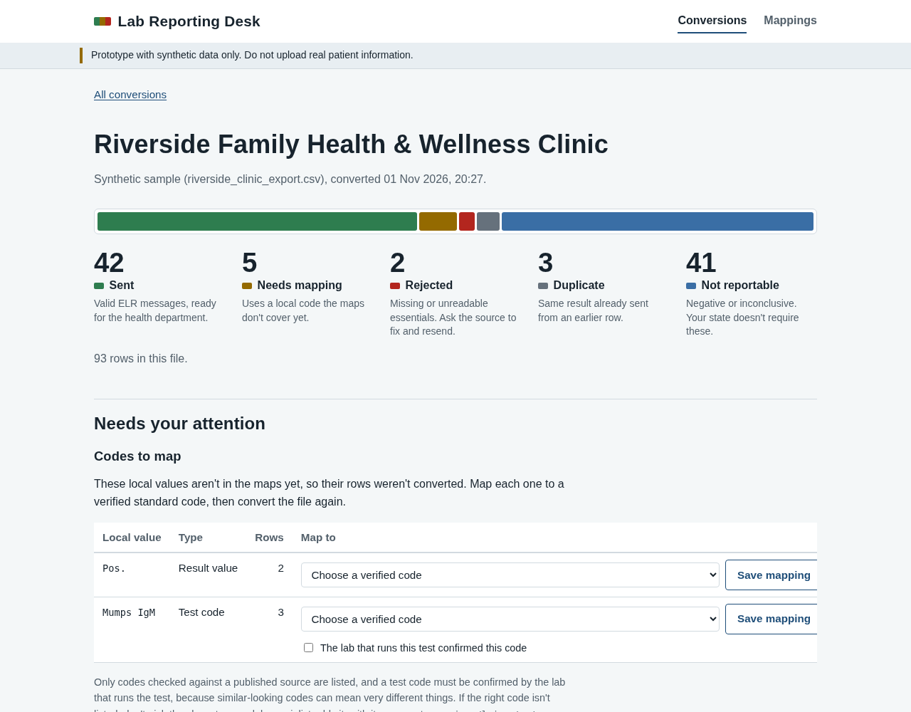
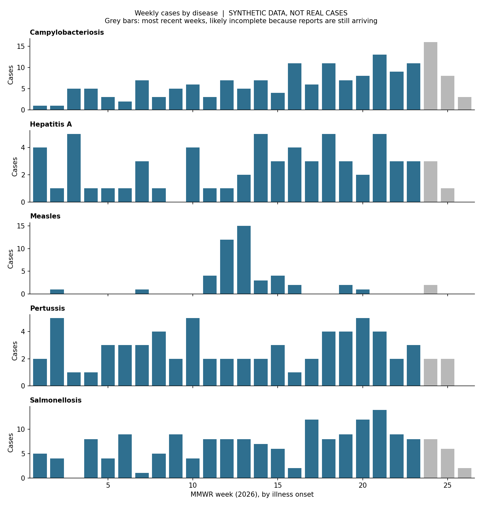

# Public Health Data Pipelines


**All data in this repository is synthetic. No real patients, facilities, or identifiers.**

Two prototype pipelines for public health data, built on established CDC and
HL7 standards and tested against synthetic data with a known answer key.

| Project | What it does |
|---|---|
| [`surveillance_pipeline/`](surveillance_pipeline/) | Cleans, validates, and deduplicates disease case reports, then produces CDC (MMWR) weekly counts, epi curves, and a data quality report |
| [`legacy_to_elr/`](legacy_to_elr/) | Converts lab exports from differently formatted legacy systems into HL7 2.5.1 Electronic Laboratory Reporting (ELR) messages coded in LOINC and SNOMED CT, with a gap report for each source |

## Quick start

Requires Python 3.11 or newer.

```
git clone https://github.com/EngineerManzini/public-health-pipelines.git
cd public-health-pipelines
python -m venv .venv
source .venv/bin/activate          # Windows: .venv\Scripts\activate
pip install -r requirements.txt
```

Then run either project:

```
cd surveillance_pipeline
python generate_data.py
python pipeline.py
python -m unittest discover tests -v
```

```
cd legacy_to_elr
python generate_legacy_data.py
python convert.py
python -m unittest discover tests -v
```

Or use the ELR converter through its web interface, the Lab Reporting Desk:

```
cd legacy_to_elr
python app.py            # then open http://127.0.0.1:5000
```

## Sample results

The Lab Reporting Desk after converting a clinic's legacy export: what was sent,
what needs mapping, and what has to go back to the source.



Weekly case counts by disease, with a planted measles outbreak visible in weeks 11 to 16:



More sample output in [`docs/`](docs/):
- [Data quality report](docs/data_quality_report.txt) (case surveillance)
- [Gap report](docs/gap_report.txt) showing what each legacy source cannot yet supply (ELR)
- [One ELR message, field by field](docs/sample_message_explained.txt)

## How correctness is checked

Each project generates synthetic data together with an answer key recording
the truth behind every record. The tests confirm that the pipelines reach the
same answers: every rejected report, every merged duplicate, every message sent.
The tests run automatically on GitHub for every push.

## Standards used

- CDC MMWR epidemiological weeks (via the `epiweeks` package)
- HL7 version 2.5.1 ELR (ORU^R01 messages)
- LOINC for lab tests, SNOMED CT for results and specimen types

## Limitations

These are prototypes. The ELR messages follow the published structure but have
not been tested with the NIST ELR validator or a state onboarding process, and
state-specific rules are not yet applied. See each project's README for details.

## License and notices

Code is MIT licensed (see [LICENSE](LICENSE)). LOINC and SNOMED CT content is
owned by its publishers; see [NOTICE.md](NOTICE.md).
